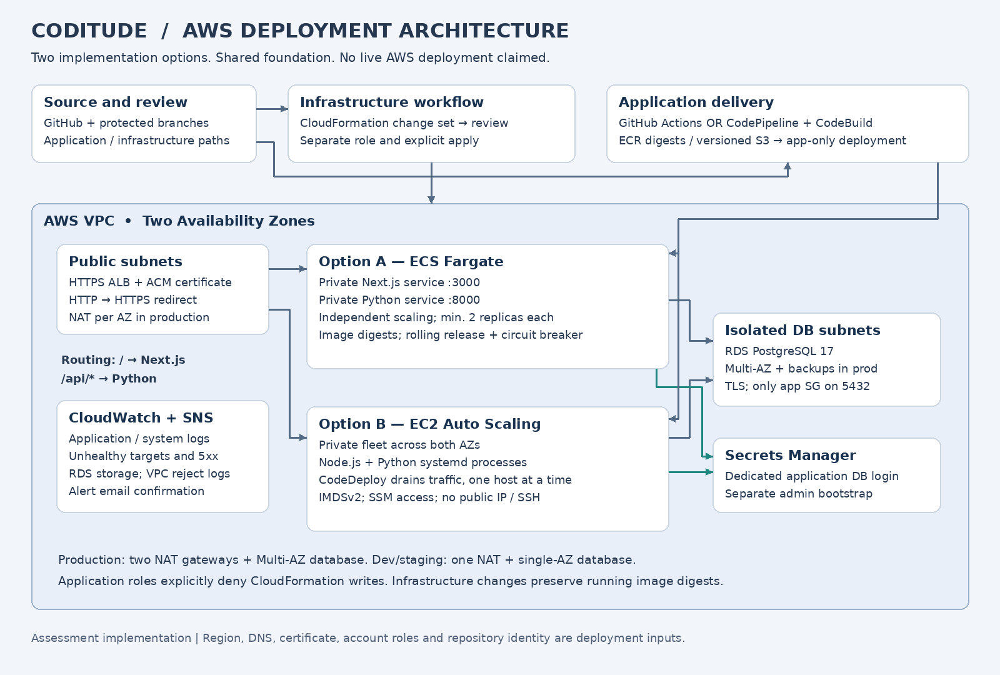
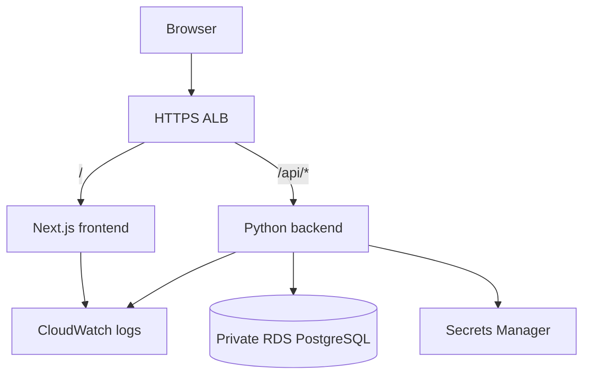

# Architecture and design decisions

## Request path

The client uses a validated DNS hostname and ACM-backed HTTPS ALB. HTTP redirects
to HTTPS. `/api/*` goes to Python on port 8000; all other paths go to Next.js on
port 3000. Both targets are private. The backend connects to private PostgreSQL
on 5432 and retrieves only the dedicated application secret at runtime.

ECS and EC2 are **alternative runtime stacks**, not a requirement to deploy both
for every release. Both are supplied to meet the assessment. They can coexist
against one foundation for a demonstration, with separate ALBs and hostnames.
In a real environment I would choose one runtime per application, to avoid
operational duplication.

## Why these services

| Decision | Reason and trade-off |
|---|---|
| ECS Fargate instead of EKS | Runs two services without managing Kubernetes control-plane and node operations. Each service scales independently. |
| EC2 Auto Scaling for non-container deployment | Clearly demonstrates native Node.js/Python services, OS lifecycle and CodeDeploy. It adds patching and runtime dependency management. |
| RDS PostgreSQL | Managed backups and failover; production uses Multi-AZ. Multi-AZ provides availability, not read scaling or regional disaster recovery. |
| CloudFormation stacks | Matches the mandatory IaC tool; separate foundation/runtime/delivery lifecycles reduce blast radius. Exports create explicit dependencies. |
| ALB path routing | Same-origin calls eliminate environment URLs compiled into frontend bundles and avoid permissive CORS. |
| Secrets Manager | Credentials remain out of source, build outputs and plaintext environment files. Environment files contain only secret ARN/host/name. |
| GitHub OIDC | Short-lived AWS sessions tied to exact repository/environment subjects; no long-lived access keys. |
| CodePipeline/CodeBuild | Native alternative for organizations that standardize on AWS-managed delivery. Only one driver is enabled for a target. |

## Availability and scale

The VPC has public, private application and isolated database subnets in two AZs.
Public subnets contain the ALB and NAT gateways. Application subnets have outbound
NAT access for package repositories and AWS public endpoints. Database subnets
have no default internet route. RDS is never publicly accessible.

Production has one NAT per AZ and a Multi-AZ PostgreSQL instance. Dev/staging use
one NAT and a single-AZ database to reduce cost; those settings intentionally do
not provide the production database/NAT availability level. Compute still starts
with two replicas/instances. ECS scales frontend and backend separately; EC2 scales
both processes together. CPU target tracking uses a 60% target.

The EC2 example places both processes on each host. It is a simpler baseline but
has a shared host identity and coupled scaling. Separate fleets and IAM instance
profiles would be the next step if isolation or scaling patterns required them.

## Health and observability

`/health` checks Next.js. `/api/health` checks Python liveness without querying the
database; a shared RDS outage should not cause the ALB/ASG to replace every healthy
process. `/api/ready` performs a real TLS PostgreSQL `SELECT 1`. Deployment smoke
tests use readiness. No business tables or schema migrations are needed by this
small demonstration application.

ECS writes stdout to CloudWatch; EC2 uses systemd log files shipped by the
CloudWatch Agent. Alarms cover unhealthy targets, application 5xx responses and
low RDS storage. SNS email alerts need subscription confirmation. VPC flow logs
record rejected traffic. A real release also needs an external availability
probe and application-specific latency/error SLOs; those are not claimed here.

## Release boundaries

Application workflows build and release artifacts. They only read stack outputs;
they never create or execute a CloudFormation change set. Their IAM policies also
explicitly deny CloudFormation writes.

Infrastructure workflows validate on PR/push. A manual plan creates a change set;
a separate apply executes its exact reviewed ARN after protected-environment
approval. For existing ECS stacks, planning reads active service image digests
rather than reusing stale bootstrap values. CloudFormation-created task definitions
and application-created revisions share a family; service task-definition drift
is expected after an app release and is reconciled on the next infrastructure
update. Never apply old parameter files directly over an existing ECS service.

When a PR changes both infrastructure and application code, merge/apply the
backward-compatible infrastructure change first, then release the application.
Use one release driver per environment and do not run infra changes concurrently
with app releases. GitHub concurrency serializes each workflow type, not both types
against each other; cross-workflow maintenance coordination is an explicit operator
responsibility in this assessment.

## References

- https://docs.aws.amazon.com/AWSCloudFormation/latest/TemplateReference/aws-resource-ecs-service.html
- https://docs.aws.amazon.com/codedeploy/latest/userguide/integrations-aws-auto-scaling.html
- https://docs.aws.amazon.com/codepipeline/latest/userguide/pipelines-triggers.html
- https://docs.aws.amazon.com/linux/al2023/ug/nodejs.html
- https://docs.aws.amazon.com/AmazonRDS/latest/PostgreSQLReleaseNotes/postgresql-versions.html
